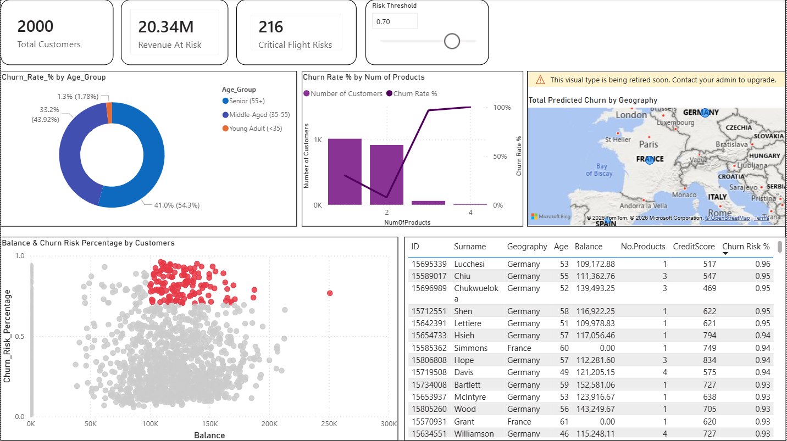

# Bank-Customer-Churn-Prediction

## Executive Summary & Business Value

Customer acquisition is roughly 5 to 25 times more expensive than customer retention. In retail banking, losing a high-net-worth individual doesn't just impact current account fees; it drains the bank's lending capital and destroys lifetime value (LTV).

This project bridges the gap between predictive analytics and proactive customer success. By deploying a leakage-safe, tuned classification model with a cross-validated operating threshold, this project shifts the retention strategy from a **reactive** approach (trying to save a customer after they initiate an account closure) to a **proactive** one (intervening before the customer makes the decision to leave).

### Model ROI & Financial Impact
Instead of applying blanket retention discounts to the entire customer base which wastes budget on loyal customers, this model enables targeted interventions. 

* **Targeted Retention:** By selecting the model using cross-validated F1 and applying an operational risk threshold, the retention team can allocate expensive perks (e.g., fee waivers, dedicated account managers) to a high-risk segment rather than wasting budget on the ~80% of the customer base that the historical data indicates is naturally loyal.
* **Capital Preservation:** Integrating the model's risk probabilities with Power BI allows stakeholders to instantly quantify **"Total Revenue at Risk."** This empowers leadership to prioritize outreach not just by churn probability, but by the highest account balances, actively protecting the bank's liquidity.
* **Strategic Resource Allocation:** Model explanations identify account activity, geography, age, balance, and related customer characteristics as important churn drivers. By isolating inactive customers in higher-risk geographical segments, the marketing department can deploy specific, localized re-engagement campaigns rather than generic, bank-wide blasts.

### The Final Deliverable
This repository contains the end-to-end pipeline: from raw data ingestion and feature engineering to model hyperparameter tuning. The final output is an exported dataset containing precise churn probability scores, designed specifically to feed directly into a BI tool for daily executive monitoring.

### Reproducible modelling workflow

The authoritative, leakage-safe workflow is [`notebook/Leakage_Safe_Modeling.ipynb`](notebook/Leakage_Safe_Modeling.ipynb). It performs model comparison and hyperparameter tuning using stratified cross-validation on the training partition only. It evaluates candidate thresholds of 0.35, 0.40, 0.45, and 0.50 using out-of-fold predictions, selects the model and threshold by cross-validated F2, and then evaluates the selected configuration once on a sealed holdout set. The original `Churn_Prediction.ipynb` is retained as historical exploratory analysis.

For a non-interactive run:

```bash
python run_modeling.py
python -m unittest discover -s tests -v
```

Generated CV, holdout, and Power BI prediction outputs are written under `reports/`.

## Methodology

1. **Exploratory Data Analysis:** Investigated the 79/21 class imbalance and visualized the relationship between demographics (Geography, Gender) and financial behavior (Balance, Active Status) with churn.
2. **Feature Engineering:** Created new logical variables, such as `Balance_per_Age` ratios and a `High_Risk_Profile` flag for inactive customers in high-churn regions.
3. **Data Preprocessing:** Utilized `scikit-learn`'s `ColumnTransformer` to apply `StandardScaler` to numerical features and `OneHotEncoder` to categorical features strictly after the train-test split to prevent data leakage.
4. **Model Selection:** Trained and tuned multiple classification algorithms:
   - Logistic Regression
   - Support Vector Machine (SVM)
   - Random Forest Classifier
   - XGBoost
5. **Selection and Evaluation:** Selected the model and operating threshold using mean five-fold cross-validated F2 on the training partition, then evaluated the selected configuration once on the untouched holdout partition using accuracy, precision, recall, F1, F2, and ROC-AUC.

F2 is used because the business cost of missing a real churner can exceed the cost of contacting a customer who would have stayed. The threshold is selected from the candidate list using training-partition cross-validation; it is not tuned on the holdout set. Accuracy is reported but is not used alone to declare the winner.

## Key Insights & Actionable Recommendations
*Interpretability is just as important as accuracy. Using EDA and Feature Importances, the model revealed:*

1. **The "Wealth" Flight Risk:** Customers with unusually high account balances are churning at a higher rate than low-balance customers. *Recommendation: Implement targeted premium perk programs or highly competitive interest rate matching for the top 10% of balance holders.*
2. **The Geography Factor:** Customers located in Germany are significantly more likely to exit compared to those in France or Spain. *Recommendation: Investigate regional competitor offerings or localized customer service issues in the German market.*
3. **Non-linear Risk Patterns (SHAP):** SHAP explanations are generated after model selection using the fitted XGBoost pipeline and encoded feature names. They show which characteristics contribute most to churn predictions and help investigate nonlinear relationships among age, credit score, balance, activity, geography, and engineered ratio features. These associations describe model behavior; they are not proof of causal effects.
4. **Activity Status:** Inactive members are a strong leading indicator of churn. *Recommendation: Deploy automated re-engagement campaigns before an account officially closes.*

*Beyond feature importance, the notebooks include optional **DiCE (Diverse Counterfactual Explanations)** analysis to generate individualized retention scenarios:*

5. **Actionable Recourse (Beyond "Why" to "How"):** While feature importance tells us why a cohort churns, counterfactual explanations generate hypothetical changes that could move an *individual* to the opposite predicted class. In the leakage-safe notebook, DiCE varies `NumOfProducts`, `IsActiveMember`, and `CreditScore` while using training-partition data as its reference. For example, a high-risk customer may receive a scenario involving an additional product or active membership. These scenarios can support retention playbooks, but they are model-based suggestions rather than guaranteed causal interventions.
*Recommendation: Use counterfactuals to design and test personalized offers, subject to business constraints, customer consent, and outcome monitoring.*

6. **Counterfactual Verification:** In the exploratory notebook, synthetic profiles generated by DiCE are fed back through the live scikit-learn pipeline to verify their predicted outcomes. This is a model-consistency check, not a guarantee that changing a customer attribute will cause retention in the real world.
*Recommendation: Treat DiCE results as hypotheses for retention experiments and validate them against business constraints, customer consent, and observed intervention outcomes before using them operationally.*

## Interactive Power BI Dashboard: From Predictions to Business Action

While machine learning models are built in Python, business decisions are driven by interactive BI tools. To bridge the gap between predictive analytics and operational strategy, the final predictions and risk probabilities were exported from the selected model using its cross-validated threshold and visualized in **Power BI**. 

**The Purpose:** To transform abstract machine learning probabilities (e.g., "0.82 risk") into quantifiable financial metrics (e.g., "$125,000 at risk") and empower the retention team to operationalize the model without needing to read code.

### Dashboard Highlights & Functionality:
* **Dynamic 'Revenue at Risk' (What-If Parameter):** Built a custom DAX numeric range parameter that allows stakeholders to dynamically adjust the model's risk threshold (e.g., sliding from a 50% risk cutoff to an 80% risk cutoff). The dashboard instantly recalculates the total capital at risk, enabling leaders to balance their retention budget against the most critical flight risks.
* **The Scatter Plot:** Engineered custom DAX conditional formatting to visually isolate high-net-worth individuals who also exhibit a high probability of churning. High-balance, high-risk targets automatically highlight in red, giving the VIP banking team an immediate priority matrix.
* **Operational 'Hit List':** A dynamically sorted matrix table that maps the ML predictions back to the original `CustomerID`. This provides customer success managers with a daily, pre-ranked list of exactly who to call, complete with demographic context like geography and active status.

*(Below is a screenshot of the interactive dashboard in action)*


## Technologies Used
* **Python** (Pandas, NumPy)
* **Machine Learning:** Scikit-Learn, XGBoost
* **Visualization:** Matplotlib, Seaborn, PowerBI
